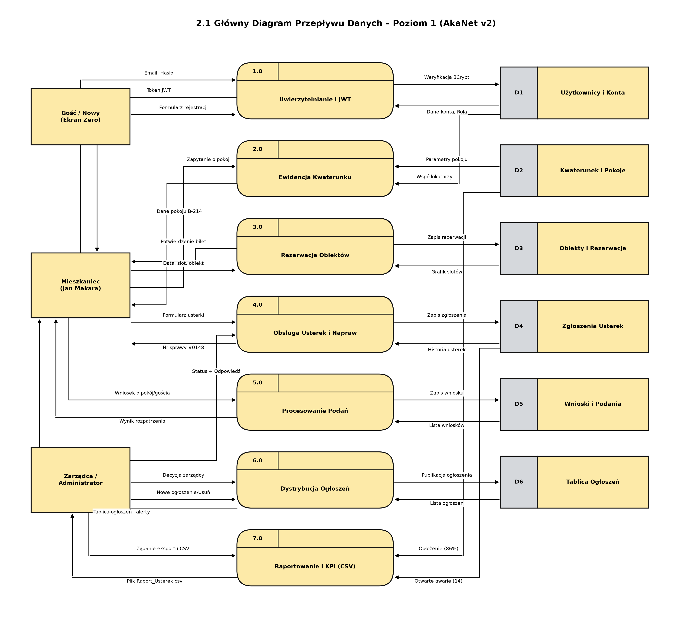
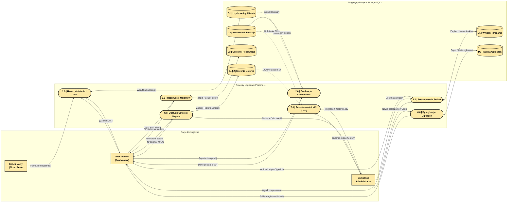

# 2.1 Główny Diagram DFD Poziomu 1 (Pełny)
**Projekt:** AkaNet v2 – System Zarządzania Domem Studenckim  
**Typ diagramu:** DFD Poziom 1 (Data Flow Diagram Level 1)  
**Notacja:** Gane-Sarson / Yourdon-DeMarco (zgodna ze schematem `DFD.png`)  

---

## Wygenerowany Obraz Diagramu (Wysoka Rozdzielczość)

---

## Wizualizacja Mermaid

---

## Źródło PlantUML (.puml)
Plik źródłowy: [`2.1_DFD_Poziom_1_Glowny.puml`](2.1_DFD_Poziom_1_Glowny.puml)
