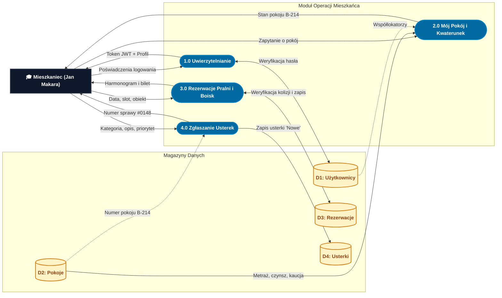

# 2.2A DFD Poziom 1 – Podsystem Mieszkańca i Zasobów Wspólnych
**Projekt:** AkaNet v2 – System Zarządzania Domem Studenckim  
**Perspektywa:** Ścieżka studenta / lokatora (Jan Makara)  
**Notacja:** Gane-Sarson / Yourdon-DeMarco  

---

## Opis Podsystemu
Diagram modeluje wszystkie interakcje studenta z systemem:
1. **1.0 Uwierzytelnianie:** logowanie adresem e-mail i hasłem, generowanie tokenu JWT.
2. **2.0 Mój Pokój i Kwaterunek:** podgląd przydzielonego pokoju (np. B-214), lista współlokatorów, status opłat i kaucji.
3. **3.0 Rezerwacje Pralni i Boisk:** przeglądanie grafiku 5-dniowego, blokada zajętych terminów, generowanie biletu rezerwacji.
4. **4.0 Zgłaszanie Usterek:** wysłanie formularza z automatycznym powiązaniem numeru pokoju lokatora, uzyskanie numeru sprawy `#0148`.

---

## Wizualizacja Mermaid

---

## Źródło PlantUML (.puml)
Plik źródłowy: [`2.2A_DFD_Poziom_1_Mieszkaniec.puml`](2.2A_DFD_Poziom_1_Mieszkaniec.puml)
