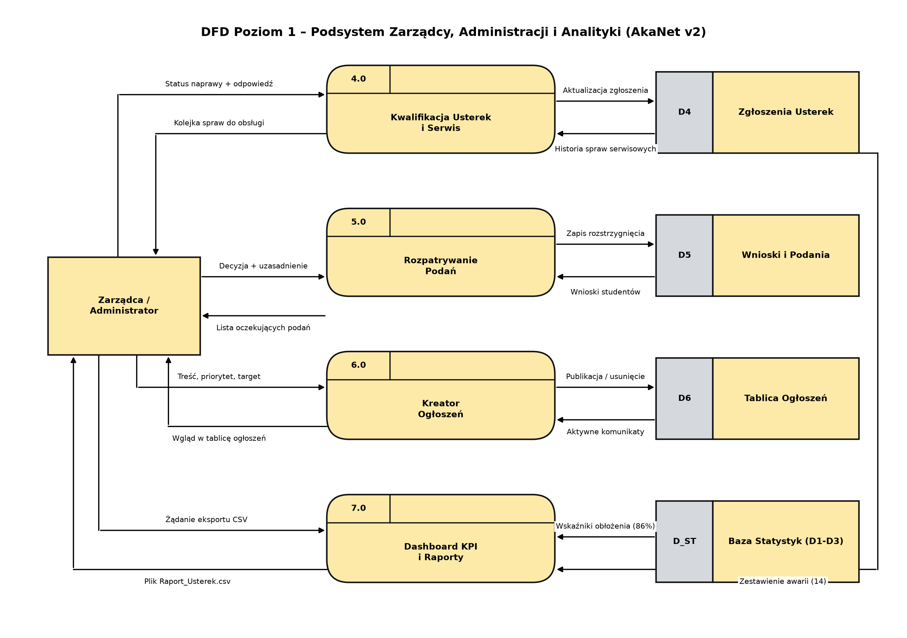

# 2.2B DFD Poziom 1 – Podsystem Zarządcy, Administracji i Analityki
**Projekt:** AkaNet v2 – System Zarządzania Domem Studenckim  
**Perspektywa:** Centrum operacyjne zarządcy i technika  
**Notacja:** Gane-Sarson / Yourdon-DeMarco (zgodna ze schematem `DFD.png`)  

---

## Wygenerowany Obraz Diagramu (Wysoka Rozdzielczość)

---

## Opis Podsystemu
Diagram modeluje operacje realizowane w panelu administratora:
1. **4.0 Kwalifikacja Usterek:** przegląd kolejki zgłoszeń, zmiana statusów (*W trakcie*, *Rozwiązane*), oficjalna odpowiedź serwisu.
2. **5.0 Rozpatrywanie Podań:** decyzje formalne w sprawach wniosków studentów z uzasadnieniem.
3. **6.0 Kreator Ogłoszeń:** tworzenie komunikatów z podglądem mobilnym, wybór grupy docelowej, publikacja i kasowanie wpisów.
4. **7.0 Dashboard KPI i Raporty:** agregacja wskaźników obłożenia (86%, 412 lokatorów) i bezpośredni eksport raportu do pliku CSV.

---

## Źródło PlantUML (.puml)
Plik źródłowy: [`2.2B_DFD_Poziom_1_Zarzadca.puml`](2.2B_DFD_Poziom_1_Zarzadca.puml)
