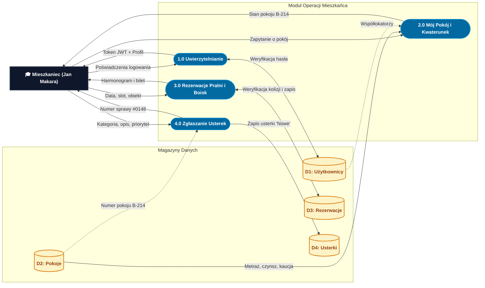

# Diagramy Przepływu Danych (DFD Poziom 1) – AkaNet v2

W tym katalogu znajdują się diagramy przepływu danych (**DFD Poziom 1**) opracowane w oparciu o architekturę systemu **AkaNet v2**.

Zastosowano architekturę **3-Tier (`flowchart LR`)** eliminującą przecinanie się linii ("spaghetti diagram"):
- **Kolumna 1 (Lewa):** Encje Zewnętrzne (Terminatory / Użytkownicy)
- **Kolumna 2 (Środek):** Procesy Biznesowe
- **Kolumna 3 (Prawa):** Relacyjne Magazyny Danych (PostgreSQL)

---

## Spis Diagramów

1. [2.1 Główny Diagram DFD Poziomu 1 (Pełny, Kolumnowy)](#21-główny-diagram-poziomu-1-pełny-kolumnowy) – pliki: [`2.1_DFD_Poziom_1_Glowny.md`](2.1_DFD_Poziom_1_Glowny.md), [`2.1_DFD_Poziom_1_Glowny.puml`](2.1_DFD_Poziom_1_Glowny.puml)
2. [2.2A Podsystem Mieszkańca i Zasobów Wspólnych](#22a-podsystem-mieszkańca-i-zasobów-wspólnych-student-view) – pliki: [`2.2A_DFD_Poziom_1_Mieszkaniec.md`](2.2A_DFD_Poziom_1_Mieszkaniec.md), [`2.2A_DFD_Poziom_1_Mieszkaniec.puml`](2.2A_DFD_Poziom_1_Mieszkaniec.puml)
3. [2.2B Podsystem Zarządcy, Administracji i Analityki](#22b-podsystem-zarządcy-administracji-i-analityki-admin-view) – pliki: [`2.2B_DFD_Poziom_1_Zarzadca.md`](2.2B_DFD_Poziom_1_Zarzadca.md), [`2.2B_DFD_Poziom_1_Zarzadca.puml`](2.2B_DFD_Poziom_1_Zarzadca.puml)

---

## 2.1 Główny Diagram Poziomu 1 (Pełny, Kolumnowy)

Prezentuje pełny system: wszystkich aktorów, wszystkie 7 procesów oraz 6 magazynów bazy danych.

```mermaid
flowchart LR
    %% Style elementów
    classDef entity fill:#0F172A,stroke:#334155,stroke-width:2px,color:#FFFFFF,font-weight:bold;
    classDef proc fill:#1D4ED8,stroke:#1E40AF,stroke-width:2px,color:#FFFFFF,font-weight:bold;
    classDef store fill:#FEF3C7,stroke:#D97706,stroke-width:2px,color:#92400E,font-weight:bold;

    %% 1. ENCJE ZEWNĘTRZNE
    subgraph ENCJE ["1. Encje Zewnętrzne"]
        direction TB
        GUEST["👤 Gość / Nowy"]:::entity
        STUDENT["🎓 Mieszkaniec (Jan Makara)"]:::entity
        ADMIN["🏛️ Zarządca / Technik"]:::entity
    end

    %% 2. PROCESY PRZETWARZANIA
    subgraph PROCESY ["2. Procesy Logiczne (Poziom 1)"]
        direction TB
        subgraph MOD_AUTH ["Moduł Tożsamości i Kwaterunku"]
            direction TB
            P1(["1.0 Uwierzytelnianie i JWT"]):::proc
            P2(["2.0 Ewidencja Kwaterunku i Pokoi"]):::proc
        end
        subgraph MOD_OPS ["Moduł Zasobów i Serwisu"]
            direction TB
            P3(["3.0 Rezerwacje Pralni i Boisk"]):::proc
            P4(["4.0 Obsługa Zgłoszeń i Usterek"]):::proc
        end
        subgraph MOD_ADM ["Moduł Administracyjny i Analityki"]
            direction TB
            P5(["5.0 Procesowanie Podań"]):::proc
            P6(["6.0 Dystrybucja Ogłoszeń"]):::proc
            P7(["7.0 Raportowanie i KPI"]):::proc
        end
    end

    %% 3. MAGAZYNY DANYCH
    subgraph BAZA ["3. Magazyny Danych (PostgreSQL 16)"]
        direction TB
        D1[("D1: Użytkownicy i Konta")]:::store
        D2[("D2: Kwaterunek i Pokoje")]:::store
        D3[("D3: Obiekty i Rezerwacje")]:::store
        D4[("D4: Zgłoszenia Usterek")]:::store
        D5[("D5: Wnioski i Podania")]:::store
        D6[("D6: Tablica Ogłoszeń")]:::store
    end

    %% PRZEPŁYWY DANYCH
    %% 1.0 Auth
    GUEST -->|Rejestracja| P1
    STUDENT -->|Email, hasło| P1
    ADMIN -->|Email, hasło| P1
    P1 <-->|Weryfikacja BCrypt| D1
    P1 -->|Token JWT + Profil| STUDENT
    P1 -->|Token JWT + Rola| ADMIN

    %% 2.0 Pokoje
    STUDENT -->|Zapytanie o pokój| P2
    ADMIN -->|Filtr lokatora/pokoju| P2
    D2 -->|Metraż, piętro, czynsz| P2
    D1 -.->|Współlokatorzy| P2
    P2 -->|Dane pokoju B-214 + czynsz| STUDENT
    P2 -->|Kartoteka pokoi i studentów| ADMIN

    %% 3.0 Rezerwacje
    STUDENT -->|Slot, data, obiekt| P3
    P3 <-->|Odczyt slotów / Zapis rezerwacji| D3
    P3 -->|Harmonogram i potwierdzenie| STUDENT

    %% 4.0 Usterki
    STUDENT -->|Formularz usterki| P4
    D2 -.->|Autoprzypisanie pokoju| P4
    P4 <-->|Zapis usterki / Odczyt| D4
    ADMIN -->|Status + Odpowiedź serwisu| P4
    P4 -->|Nr sprawy #0148 + status| STUDENT
    P4 -->|Kolejka awarii| ADMIN

    %% 5.0 Podania
    STUDENT -->|Wniosek o pokój/gościa| P5
    P5 <-->|Zapis wniosku / Odczyt| D5
    ADMIN -->|Decyzja i uzasadnienie| P5
    P5 -->|Status petycji| STUDENT
    P5 -->|Kolejka podań| ADMIN

    %% 6.0 Ogłoszenia
    ADMIN -->|Nowe ogłoszenie / Usuń| P6
    P6 <-->|Zapis / Odczyt ogłoszeń| D6
    P6 -->|Alerty i biuletyn| STUDENT
    P6 -->|Lista komunikatów| ADMIN

    %% 7.0 Raporty
    D1 -.->|Lokatorzy (412)| P7
    D2 -.->|Obłożenie (86%)| P7
    D4 -.->|Usterki (14)| P7
    D3 -.->|Rezerwacje (38)| P7
    D5 -.->|Podania (27)| P7
    ADMIN -->|Żądanie eksportu CSV| P7
    P7 -->|Pulpit KPI na żywo| ADMIN
    P7 -->|Plik Raport_Usterek.csv| ADMIN
```

---

## 2.2A Podsystem Mieszkańca i Zasobów Wspólnych (Student View)

Diagram dedykowany do prezentacji ścieżki studenta: uwierzytelnianie, karta pokoju, harmonogram pralni/boisk, rejestracja usterek.



---

## 2.2B Podsystem Zarządcy, Administracji i Analityki (Admin View)

Diagram dedykowany do prezentacji centrum operacyjnego: kwalifikacja napraw, obsługa podań, tablica ogłoszeń, wskaźniki KPI i raporty CSV.

```mermaid
flowchart LR
    classDef entity fill:#0F172A,stroke:#334155,stroke-width:2px,color:#FFFFFF,font-weight:bold;
    classDef proc fill:#15803D,stroke:#166534,stroke-width:2px,color:#FFFFFF,font-weight:bold;
    classDef store fill:#FEF3C7,stroke:#D97706,stroke-width:2px,color:#92400E,font-weight:bold;

    ADMIN["🏛️ Zarządca / Administrator"]:::entity

    subgraph PROCESY_ADMIN ["Centrum Operacyjne Zarządcy"]
        direction TB
        P4A(["4.0 Kwalifikacja Usterek"]):::proc
        P5A(["5.0 Rozpatrywanie Podań"]):::proc
        P6A(["6.0 Kreator Ogłoszeń"]):::proc
        P7A(["7.0 Dashboard KPI i Raporty"]):::proc
    end

    subgraph BAZA_B ["Magazyny Danych"]
        direction TB
        D4[("D4: Usterki")]:::store
        D5[("D5: Podania")]:::store
        D6[("D6: Ogłoszenia")]:::store
        D_STATS[("D1, D2, D3: Statystyki")]:::store
    end

    ADMIN -->|Status naprawy + odpowiedź| P4A
    P4A <-->|Aktualizacja zgłoszenia| D4
    P4A -->|Kolejka spraw| ADMIN

    ADMIN -->|Decyzja + uzasadnienie| P5A
    P5A <-->|Zatwierdzenie / odmowa| D5
    P5A -->|Lista oczekujących wniosków| ADMIN

    ADMIN -->|Treść, priorytet, target| P6A
    P6A <-->|Publikacja / usunięcie| D6
    P6A -->|Podgląd tablicy ogłoszeń| ADMIN

    ADMIN -->|Żądanie eksportu| P7A
    D_STATS -.->|Agregacja wskaźników| P7A
    D4 -.->|Zestawienie awarii| P7A
    P7A -->|Statystyki live (obłożenie 86%)| ADMIN
    P7A -->|Plik Raport_Usterek.csv| ADMIN
```
