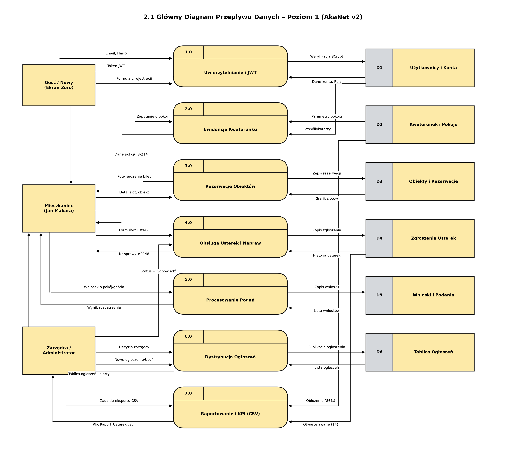
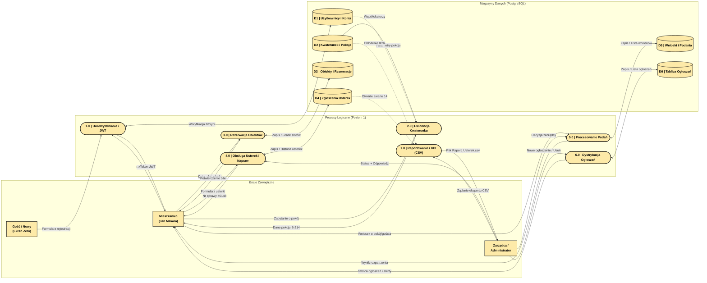
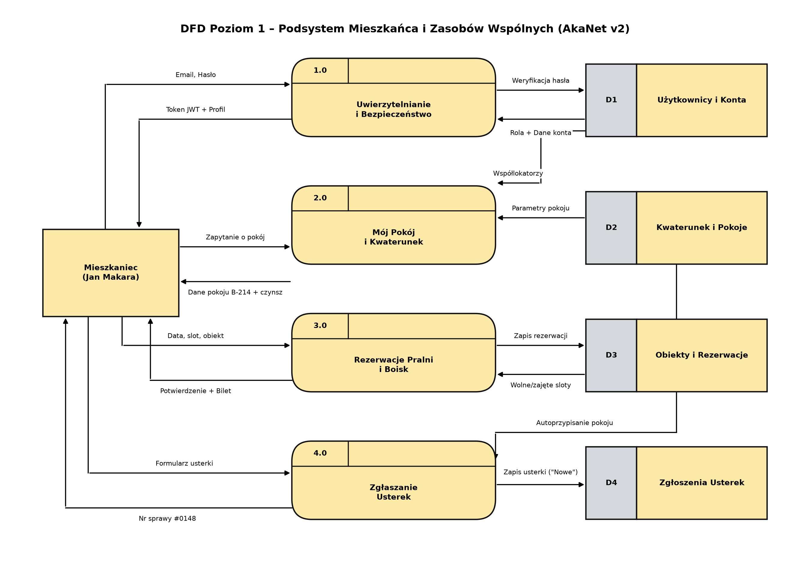
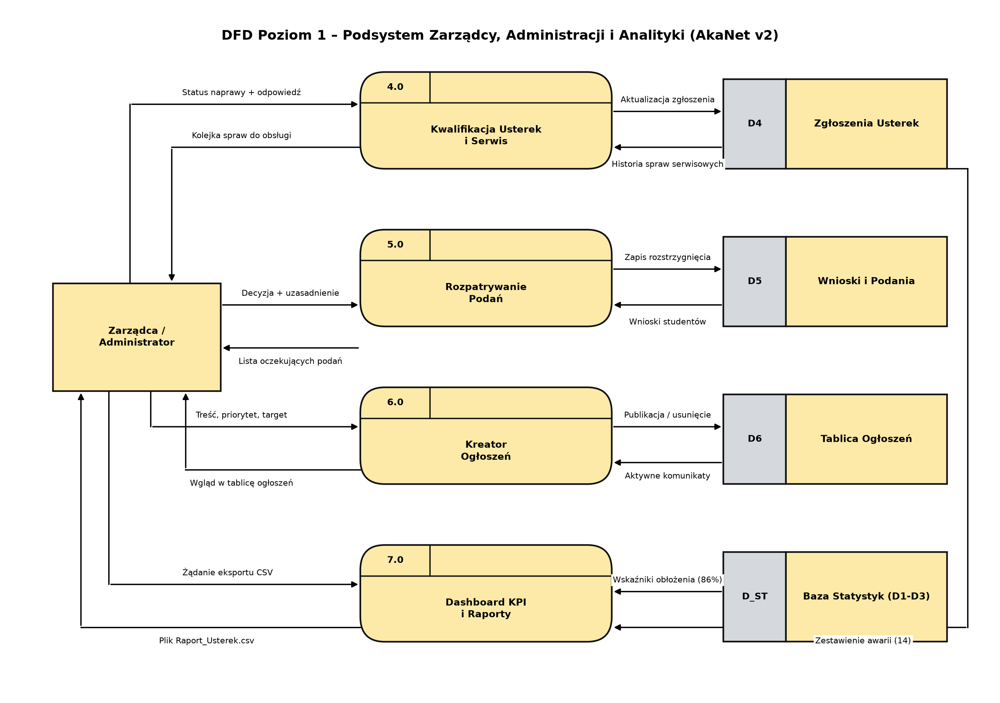

# Diagramy Przepływu Danych (DFD Poziom 1) – AkaNet v2

Diagramy przepływu danych (**DFD Poziom 1**) zgodne ze ścisłą notacją **Gane-Sarson / Yourdon-DeMarco**, odzwierciedlające wygląd wzorcowego diagramu inżynierskiego ([`DFD.png`](../DFD.png)):
- **Procesy:** Zaokrąglone żółte bloki z górnym paskiem nagłówka i numerem procesu w lewym rogu (`1.0`, `2.0`...).
- **Magazyny Danych:** Bloki z szarym separatorem identyfikatora (`D1`–`D6`) i żółtą sekcją nazwy tabeli bazy PostgreSQL.
- **Encje Zewnętrzne:** Klasyczne żółte prostokąty z wyraźną czarną ramką.
- **Przepływy:** Prostopadłe (ortogonalne) linie ze strzałkami i czytelnymi etykietami.

---

## Spis Diagramów

1. [2.1 Główny Diagram DFD Poziomu 1 (Pełny)](#21-główny-diagram-poziomu-1-pełny) – plik graficzny: [`2.1_DFD_Poziom_1_Glowny.png`](2.1_DFD_Poziom_1_Glowny.png)
2. [2.2A Podsystem Mieszkańca i Zasobów Wspólnych](#22a-podsystem-mieszkańca-i-zasobów-wspólnych-student-view) – plik graficzny: [`2.2A_DFD_Poziom_1_Mieszkaniec.png`](2.2A_DFD_Poziom_1_Mieszkaniec.png)
3. [2.2B Podsystem Zarządcy, Administracji i Analityki](#22b-podsystem-zarządcy-administracji-i-analityki-admin-view) – plik graficzny: [`2.2B_DFD_Poziom_1_Zarzadca.png`](2.2B_DFD_Poziom_1_Zarzadca.png)

---

## 2.1 Główny Diagram Poziomu 1 (Pełny)

### Kod Mermaid (do edycji online / podglądu tekstowego)

---

## 2.2A Podsystem Mieszkańca i Zasobów Wspólnych (Student View)

Dedykowany widok ścieżki studenta – kwaterunek, pralnie/boiska oraz zgłoszenia napraw.

Plik źródłowy PlantUML: [`2.2A_DFD_Poziom_1_Mieszkaniec.puml`](2.2A_DFD_Poziom_1_Mieszkaniec.puml)

---

## 2.2B Podsystem Zarządcy, Administracji i Analityki (Admin View)

Dedykowany widok centrum operacyjnego zarządcy – serwis techniczny, rozpatrywanie podań, tablica ogłoszeń oraz raportowanie.

Plik źródłowy PlantUML: [`2.2B_DFD_Poziom_1_Zarzadca.puml`](2.2B_DFD_Poziom_1_Zarzadca.puml)
