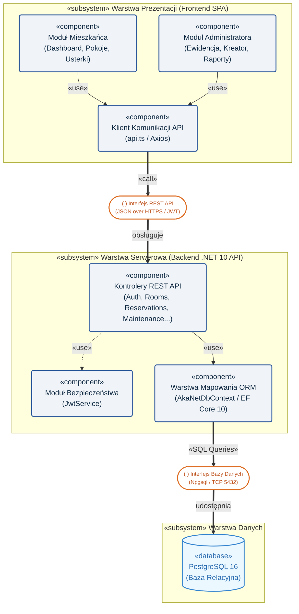
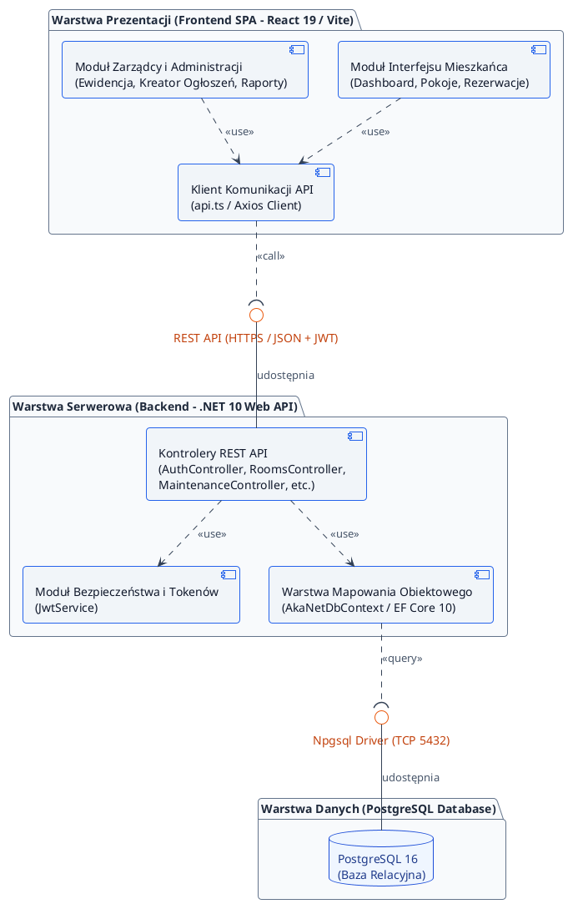

# Diagram Struktury: Widok Deweloperski (UML Component Diagram)
**Projekt:** AkaNet v2 – System Zarządzania Domem Studenckim  
**Data wygenerowania:** 2026-11-03  

---

## 1. Wizualizacja Mermaid (Podgląd w Markdown)

---

## 2. Źródło PlantUML (.puml)

Plik źródłowy znajduje się w: [`docs/diagram_komponentow.puml`](file:///Users/jano/ai/git_repos/ZarzAka_v2/docs/diagram_komponentow.puml)

---

## 3. Opis architektoniczny do sprawozdania / pracy dyplomowej

### Cel i widok architektoniczny
Diagram przedstawia **Widok deweloperski (Development View)** zgodnie z modelem widoków architektonicznych Kruchtena 4+1, wykonany w notacji **UML 2.5 Component Diagram**. Koncentruje się na organizacji modułów oprogramowania, pakietów oraz interfejsów łączących poszczególne warstwy.

### Opis warstw i komponentów:
1. **Warstwa Prezentacji (Frontend SPA):**
   - Zrealizowana w bibliotece **React 19** przy użyciu narzędzia **Vite** i stylizacji **Tailwind CSS**.
   - Składa się z modułów widoków dedykowanych mieszkańcom (pulpit lokatora, rezerwacje, zgłoszenia usterek) oraz zarządcy (panel administracyjny, wyszukiwarka pokoi i mieszkańców, kreator ogłoszeń).
   - Wszystkie moduły korzystają z centralnego komponentu komunikacyjnego **`api.ts`**, realizującego żądania asynchroniczne HTTP oraz zarządzanie tokenem autoryzacyjnym.
2. **Warstwa Serwerowa (Backend Web API):**
   - Oparta na frameworku **.NET 10 Core**.
   - Wystawia interfejs **REST API** zabezpieczony nagłówkami `Authorization: Bearer <JWT>`.
   - Moduł **Kontrolerów REST** odbiera żądania, weryfikuje uprawnienia w porozumieniu z usługą **`JwtService`**, a następnie operuje na logice biznesowej i danych.
   - Komponent mapowania obiektowo-relacyjnego **`AkaNetDbContext` (Entity Framework Core 10)** tłumaczy operacje domenowe na zapytania SQL.
3. **Warstwa Danych (Baza Danych):**
   - Silnik bazy relacyjnej **PostgreSQL 16**.
   - Połączenie realizowane jest z wykorzystaniem oficjalnego sterownika **Npgsql** poprzez bezpieczny port TCP 5432.

---

## 4. Jak wygenerować plik graficzny (PNG / SVG / PDF)?

- **Sposób 1 (Najszybszy online - PlantUML):**
  1. Wejdź na [https://www.planttext.com](https://www.planttext.com).
  2. Wklej zawartość pliku [`docs/diagram_komponentow.puml`](file:///Users/jano/ai/git_repos/ZarzAka_v2/docs/diagram_komponentow.puml).
  3. Kliknij **PNG** lub **SVG** aby pobrać gotowy obraz w wysokiej rozdzielczości.
- **Sposób 2 (Mermaid Live Editor):**
  1. Wejdź na [https://mermaid.live](https://mermaid.live).
  2. Wklej blok kodu Mermaid z sekcji 1.
  3. Pobierz plik klikając przycisk **Download PNG** lub **Download SVG**.
