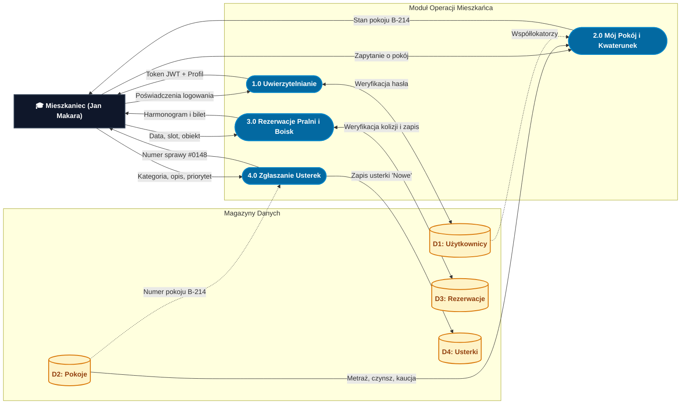

# Diagram Przepływu Danych (DFD - Data Flow Diagram)
**Projekt:** AkaNet v2 – System Zarządzania Domem Studenckim (*Akademik Olimp*)  
**Standard notacji:** Gane-Sarson / Yourdon-DeMarco  
**Wersja:** 2.1 (Zoptymalizowana wizualnie do obrony projektu)  
**Data opracowania:** 2026-11-04  

---

## 1. DFD Poziom 0 – Diagram Kontekstowy (Context Diagram)

Diagram kontekstowy definiuje granice systemu **AkaNet v2** jako pojedynczego procesu centralnego `0.0` oraz jego bezpośrednie interakcje ze wszystkimi aktorami zewnętrznymi.

```mermaid
flowchart TD
    classDef entity fill:#0F172A,stroke:#334155,stroke-width:2px,color:#FFFFFF,font-weight:bold;
    classDef system fill:#0284C7,stroke:#0369A1,stroke-width:3px,color:#FFFFFF,font-weight:bold;

    GUEST["👤 Gość / Niezalogowany"]:::entity
    RESIDENT["🎓 Mieszkaniec (Student)"]:::entity
    ADMIN["🏛️ Administrator / Zarządca"]:::entity

    SYSTEM(("&nbsp;&nbsp;0.0&nbsp;&nbsp;<br/>SYSTEM ZARZĄDZANIA<br/>DOMEM STUDENCKIM<br/>AKANET v2")):::system

    %% Interakcje Gościa
    GUEST -->|Podgląd infrastruktury i regulaminu| SYSTEM
    SYSTEM -->|Dane publiczne, stan obłożenia, modal logowania| GUEST
    GUEST -->|Formularz rejestracji konta| SYSTEM

    %% Interakcje Mieszkańca
    RESIDENT -->|Poświadczenia logowania (Email, Hasło)| SYSTEM
    SYSTEM -->|Token JWT, Profil mieszkańca, Dane pokoju B-214| RESIDENT
    RESIDENT -->|Rezerwacja pralni / suszarni / boiska| SYSTEM
    SYSTEM -->|Potwierdzenie rezerwacji, Dostępne terminy| RESIDENT
    RESIDENT -->|Zgłoszenie usterki (kategoria, opis, priorytet)| SYSTEM
    SYSTEM -->|Status naprawy, Odpowiedź technika| RESIDENT
    RESIDENT -->|Wniosek studencki (zmiana pokoju, gość, pobyt)| SYSTEM
    SYSTEM -->|Decyzja administracyjna z uzasadnieniem| RESIDENT
    SYSTEM -->|Biuletyn ogłoszeń i komunikaty techniczne| RESIDENT

    %% Interakcje Administratora
    ADMIN -->|Poświadczenia administratora| SYSTEM
    SYSTEM -->|Token JWT, Pulpit operacyjny KPI (obłożenie, awarie)| ADMIN
    ADMIN -->|Zapytanie wyszukiwarki (Pokój / Lokator)| SYSTEM
    SYSTEM -->|Kartoteka mieszkańców, Dane pokoi, Alokacja miejsc| ADMIN
    ADMIN -->|Aktualizacja statusu naprawy + Komentarz serwisu| SYSTEM
    ADMIN -->|Decyzja administracyjna (Zatwierdzenie/Odrzucenie wniosku)| SYSTEM
    ADMIN -->|Nowe ogłoszenie (Treść, Priorytet, Grupa docelowa)| SYSTEM
    SYSTEM -->|Wygenerowany raport usterek (Eksport CSV)| ADMIN
```

---

## 2. DFD Poziom 1 – Dekompozycja Funkcjonalna Systemu

> [!TIP] **Architektura Kolumnowa (3-Tier DFD):**  
> W celu wyeliminowania chaosu wizualnego i krzyżowania się linii, diagram został zorganizowany w układzie poziomym (`flowchart LR`):
> 1. **Lewa kolumna:** Encje Zewnętrzne (Terminatory / Źródła danych)
> 2. **Środkowa kolumna:** Moduły Procesów Biznesowych (1.0 – 7.0)
> 3. **Prawa kolumna:** Relacyjne Magazyny Danych (Tabele PostgreSQL 16)

### 2.1. Główny Diagram Poziomu 1 (Pełny, Kolumnowy)

```mermaid
flowchart LR
    %% Style elementów
    classDef entity fill:#0F172A,stroke:#334155,stroke-width:2px,color:#FFFFFF,font-weight:bold;
    classDef proc fill:#1D4ED8,stroke:#1E40AF,stroke-width:2px,color:#FFFFFF,font-weight:bold;
    classDef store fill:#FEF3C7,stroke:#D97706,stroke-width:2px,color:#92400E,font-weight:bold;

    %% 1. ENCJE ZEWNĘTRZNE
    subgraph ENCJE ["1. Encje Zewnętrzne (Terminatory)"]
        direction TB
        GUEST["👤 Gość / Nowy"]:::entity
        STUDENT["🎓 Mieszkaniec (Jan Makara)"]:::entity
        ADMIN["🏛️ Zarządca / Technik"]:::entity
    end

    %% 2. PROCESY PRZETWARZANIA
    subgraph PROCESY ["2. Procesy Logiczne (Poziom 1)"]
        direction TB
        subgraph MOD_AUTH ["Moduł Tożsamości i Kwaterunku"]
            direction TB
            P1(["1.0 Uwierzytelnianie i JWT"]):::proc
            P2(["2.0 Ewidencja Kwaterunku i Pokoi"]):::proc
        end
        subgraph MOD_OPS ["Moduł Zasobów i Serwisu"]
            direction TB
            P3(["3.0 Rezerwacje Pralni i Boisk"]):::proc
            P4(["4.0 Obsługa Zgłoszeń i Usterek"]):::proc
        end
        subgraph MOD_ADM ["Moduł Administracyjny i Analityki"]
            direction TB
            P5(["5.0 Procesowanie Podań"]):::proc
            P6(["6.0 Dystrybucja Ogłoszeń"]):::proc
            P7(["7.0 Raportowanie i KPI"]):::proc
        end
    end

    %% 3. MAGAZYNY DANYCH
    subgraph BAZA ["3. Magazyny Danych (PostgreSQL 16)"]
        direction TB
        D1[("D1: Użytkownicy i Konta")]:::store
        D2[("D2: Kwaterunek i Pokoje")]:::store
        D3[("D3: Obiekty i Rezerwacje")]:::store
        D4[("D4: Zgłoszenia Usterek")]:::store
        D5[("D5: Wnioski i Podania")]:::store
        D6[("D6: Tablica Ogłoszeń")]:::store
    end

    %% PRZEPŁYWY DANYCH (Zwięzłe, uporządkowane)
    %% 1.0 Auth
    GUEST -->|Rejestracja| P1
    STUDENT -->|Email, hasło| P1
    ADMIN -->|Email, hasło| P1
    P1 <-->|Weryfikacja BCrypt| D1
    P1 -->|Token JWT + Profil| STUDENT
    P1 -->|Token JWT + Rola| ADMIN

    %% 2.0 Pokoje
    STUDENT -->|Zapytanie o pokój| P2
    ADMIN -->|Filtr lokatora/pokoju| P2
    D2 -->|Metraż, piętro, czynsz| P2
    D1 -.->|Współlokatorzy| P2
    P2 -->|Dane pokoju B-214 + czynsz| STUDENT
    P2 -->|Kartoteka pokoi i studentów| ADMIN

    %% 3.0 Rezerwacje
    STUDENT -->|Slot, data, obiekt| P3
    P3 <-->|Odczyt slotów / Zapis rezerwacji| D3
    P3 -->|Harmonogram i potwierdzenie| STUDENT

    %% 4.0 Usterki
    STUDENT -->|Formularz usterki| P4
    D2 -.->|Autoprzypisanie pokoju| P4
    P4 <-->|Zapis usterki / Odczyt| D4
    ADMIN -->|Status + Odpowiedź serwisu| P4
    P4 -->|Nr sprawy #0148 + status| STUDENT
    P4 -->|Kolejka awarii| ADMIN

    %% 5.0 Podania
    STUDENT -->|Wniosek o pokój/gościa| P5
    P5 <-->|Zapis wniosku / Odczyt| D5
    ADMIN -->|Decyzja i uzasadnienie| P5
    P5 -->|Status petycji| STUDENT
    P5 -->|Kolejka podań| ADMIN

    %% 6.0 Ogłoszenia
    ADMIN -->|Nowe ogłoszenie / Usuń| P6
    P6 <-->|Zapis / Odczyt ogłoszeń| D6
    P6 -->|Alerty i biuletyn| STUDENT
    P6 -->|Lista komunikatów| ADMIN

    %% 7.0 Raporty
    D1 -.->|Lokatorzy (412)| P7
    D2 -.->|Obłożenie (86%)| P7
    D4 -.->|Usterki (14)| P7
    D3 -.->|Rezerwacje (38)| P7
    D5 -.->|Podania (27)| P7
    ADMIN -->|Żądanie eksportu CSV| P7
    P7 -->|Pulpit KPI na żywo| ADMIN
    P7 -->|Plik Raport_Usterek.csv| ADMIN
```

---

### 2.2. Zdekomponowane Widoki Dziedzinowe Poziomu 1 (Do prezentacji i obrony projektu)

W pracach inżynierskich i sprawozdaniach projektowych zaleca się dodatkowo przedstawienie podziału na **dwa zintegrowane podsystemy**. Każdy z nich ma **zero przecięć linii** i jest w 100% czytelny na rzutniku lub wydruku A4.

#### Widok 2.2A: Podsystem Mieszkańca i Zasobów Wspólnych (Student View)
Obejmuje procesy dostępne dla studenta: logowanie, wgląd w pokój, rezerwacje pralni/boisk oraz zgłaszanie awarii.



---

#### Widok 2.2B: Podsystem Zarządcy, Administracji i Analityki (Admin View)
Obejmuje centrum operacyjne zarządcy: procesowanie podań, serwis napraw, publikację komunikatów oraz generowanie raportów CSV.

```mermaid
flowchart LR
    classDef entity fill:#0F172A,stroke:#334155,stroke-width:2px,color:#FFFFFF,font-weight:bold;
    classDef proc fill:#15803D,stroke:#166534,stroke-width:2px,color:#FFFFFF,font-weight:bold;
    classDef store fill:#FEF3C7,stroke:#D97706,stroke-width:2px,color:#92400E,font-weight:bold;

    ADMIN["🏛️ Zarządca / Administrator"]:::entity

    subgraph PROCESY_ADMIN ["Centrum Operacyjne Zarządcy"]
        direction TB
        P4A(["4.0 Kwalifikacja Usterek"]):::proc
        P5A(["5.0 Rozpatrywanie Podań"]):::proc
        P6A(["6.0 Kreator Ogłoszeń"]):::proc
        P7A(["7.0 Dashboard KPI i Raporty"]):::proc
    end

    subgraph BAZA_B ["Magazyny Danych"]
        direction TB
        D4[("D4: Usterki")]:::store
        D5[("D5: Podania")]:::store
        D6[("D6: Ogłoszenia")]:::store
        D_STATS[("D1, D2, D3: Statystyki")]:::store
    end

    ADMIN -->|Status naprawy + odpowiedź| P4A
    P4A <-->|Aktualizacja zgłoszenia| D4
    P4A -->|Kolejka spraw| ADMIN

    ADMIN -->|Decyzja + uzasadnienie| P5A
    P5A <-->|Zatwierdzenie / odmowa| D5
    P5A -->|Lista oczekujących wniosków| ADMIN

    ADMIN -->|Treść, priorytet, target| P6A
    P6A <-->|Publikacja / usunięcie| D6
    P6A -->|Podgląd tablicy ogłoszeń| ADMIN

    ADMIN -->|Żądanie eksportu| P7A
    D_STATS -.->|Agregacja wskaźników| P7A
    D4 -.->|Zestawienie awarii| P7A
    P7A -->|Statystyki live (obłożenie 86%)| ADMIN
    P7A -->|Plik Raport_Usterek.csv| ADMIN
```

---

## 3. DFD Poziom 2 – Dekompozycja Procesów Krytycznych

### 3.1. Podproces 3.0: Rezerwacja Zasobu Wspólnego (Pralnia / Boisko)

Dekompozycja procesu rezerwacji z automatyczną weryfikacją kolizji terminów (`AnyAsync(...)`) i blokowaniem podwójnych rezerwacji.


---

### 3.2. Podproces 4.0: Cykl Życia Zgłoszenia Naprawy i Raportowanie CSV

Dekompozycja ścieżki awarii – od utworzenia przez mieszkańca, przez obsługę przez konserwatora, po analityczny eksport zarządczy do pliku `.csv`.

```mermaid
flowchart TD
    classDef entity fill:#0F172A,stroke:#334155,stroke-width:2px,color:#FFFFFF,font-weight:bold;
    classDef proc fill:#0284C7,stroke:#0369A1,stroke-width:2px,color:#FFFFFF;
    classDef store fill:#FEF3C7,stroke:#D97706,stroke-width:2px,color:#92400E;

    LOKATOR["🎓 Mieszkaniec"]:::entity
    ADMIN["🏛️ Zarządca / Konserwator"]:::entity

    P41(("4.1<br/>Rejestracja Usterki<br/>z Autoprzypisaniem")):::proc
    P42(("4.2<br/>Kwalifikacja i Zmiana<br/>Statusu Naprawy")):::proc
    P43(("4.3<br/>Generowanie Raportu<br/>Usterek (CSV)")):::proc

    D1[("D1: Użytkownicy")]:::store
    D2[("D2: Pokoje")]:::store
    D4[("D4: Zgłoszenia Usterek")]:::store

    LOKATOR -->|Tytuł, Kategoria, Opis, Priorytet| P41
    D1 -.->|Pobranie RoomId użytkownika| P41
    D2 -.->|Pobranie numeru pokoju (np. B-214)| P41
    P41 -->|Zapis zgłoszenia: TicketNumber, Status 'Nowe'| D4
    P41 -->|Nadany numer zgłoszenia #0148| LOKATOR

    D4 -->|Lista spraw oczekujących| P42
    P42 -->|Widok spraw priorytetowych| ADMIN
    ADMIN -->|Nowy status ('W trakcie'/'Rozwiązane') + Odpowiedź| P42
    P42 -->|Aktualizacja: AdminResponse, ResolvedAt| D4
    P42 -->|Powiadomienie o wizycie konserwatora| LOKATOR

    ADMIN -->|Kryteria eksportu (wszystkie/otwarte)| P43
    D4 -->|Surowe rekordy usterek| P43
    P43 -->|Formatowanie UTF-8 BOM, separacja średnikami| P43
    P43 -->|Plik Raport_Usterek_AKAnet_YYYY-MM-DD.csv| ADMIN
```

---

## 4. Słownik Danych (Data Dictionary)

### 4.1. Encje Zewnętrzne (External Entities)

| Identyfikator | Nazwa Encji | Opis roli w systemie | Główne dane wejściowe | Główne dane wyjściowe |
| :--- | :--- | :--- | :--- | :--- |
| **E-01** | **Mieszkaniec (Student)** | Zameldowany lokator akademika korzystający z zasobów | Poświadczenia, zgłoszenia usterek, rezerwacje, wnioski | Token JWT, widok pokoju, statusy spraw, ogłoszenia |
| **E-02** | **Administrator / Zarządca** | Pracownik administracji zarządzający kwaterunkiem i infrastrukturą | Odpowiedzi serwisu, decyzje podań, publikacja ogłoszeń | Raporty CSV, wskaźniki KPI, kartoteka mieszkańców |
| **E-03** | **Gość / Niezalogowany** | Osoba z zewnątrz odwiedzająca witrynę systemu | Formularz logowania / rejestracji | Dane ogólne akademika, formularz autoryzacyjny |

---

### 4.2. Magazyny Danych (Data Stores)

| Symbol | Nazwa Magazynu | Odpowiadająca tabela / model | Klucz główny | Kluczowe atrybuty i typy |
| :--- | :--- | :--- | :--- | :--- |
| **D1** | **Użytkownicy i Konta** | `Users` (`User.cs`) | `Id` (INT) | `Email` (VARCHAR), `PasswordHash` (BCrypt), `FullName`, `Role`, `RoomId` (FK) |
| **D2** | **Kwaterunek i Pokoje** | `Rooms` (`Room.cs`) | `Id` (INT) | `RoomNumber` (VARCHAR), `Building`, `Floor`, `Capacity`, `MonthlyRent`, `Deposit` |
| **D3** | **Obiekty i Rezerwacje** | `Facilities`, `Reservations` | `Id` (INT) | `FacilityId` (FK), `UserId` (FK), `Date` (DATE), `TimeSlot` (VARCHAR), `Status` |
| **D4** | **Zgłoszenia Usterek** | `MaintenanceTickets` | `Id` (INT) | `TicketNumber`, `Category`, `Priority`, `Status`, `AdminResponse`, `RoomNumber` |
| **D5** | **Wnioski i Podania** | `ApplicationRequests` | `Id` (INT) | `Type`, `Title`, `Justification`, `Status`, `AdminComment`, `UserId` (FK) |
| **D6** | **Tablica Ogłoszeń** | `Announcements` | `Id` (INT) | `Title`, `Content`, `Category`, `Priority`, `TargetAudience`, `DayBadge`, `MonthBadge` |

---

### 4.3. Przepływy Danych (Data Flows)

| Nazwa Przepływu | Źródło | Przeznaczenie | Struktura / Kluczowe pola |
| :--- | :--- | :--- | :--- |
| **Poświadczenia logowania** | E-01 / E-02 | P 1.0 | `{ email: string, password: string }` |
| **Odpowiedź autoryzacyjna** | P 1.0 | E-01 / E-02 | `{ token: string (JWT), user: UserDto }` |
| **Żądanie rezerwacji** | E-01 | P 3.0 | `{ facilityId: int, date: "YYYY-MM-DD", timeSlot: "HH:MM" }` |
| **Zajęte sloty czasowe** | D3 | P 3.0 | `List<string>` (np. `["08:00", "09:00", "14:00"]`) |
| **Formularz usterki** | E-01 | P 4.0 | `{ title: string, category: string, description: string, priority: string }` |
| **Aktualizacja serwisowa** | E-02 | P 4.0 | `{ status: "W trakcie"\|"Rozwiązane", adminResponse?: string }` |
| **Wniosek studencki** | E-01 | P 5.0 | `{ type: string, title: string, justification: string }` |
| **Decyzja zarządcy** | E-02 | P 5.0 | `{ status: "Zaakceptowane"\|"Odrzucone", adminComment: string }` |
| **Nowy komunikat** | E-02 | P 6.0 | `{ title: string, content: string, priority: string, category: string, targetAudience: string }` |
| **Plik Raportu CSV** | P 7.0 | E-02 | `MIME: text/csv;charset=utf-8,\uFEFF` (Kolumny rozdzielane średnikami) |
