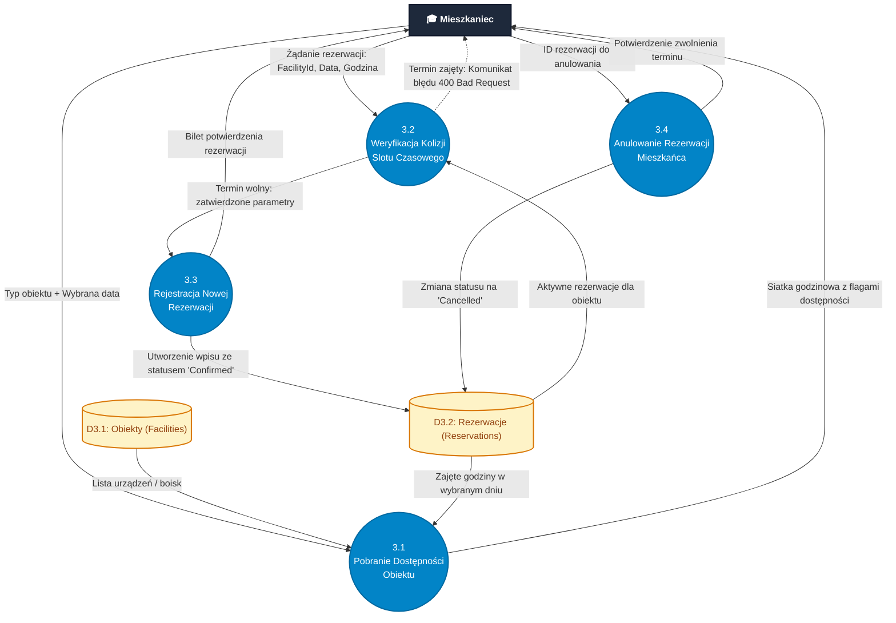

# Diagram Przepływu Danych (DFD - Data Flow Diagram)
**Projekt:** AkaNet v2 – System Zarządzania Domem Studenckim (*Akademik Olimp*)  
**Standard notacji:** Gane-Sarson / Yourdon-DeMarco  
**Wersja:** 2.0  
**Data opracowania:** 2026-11-04  

---

## 1. Wprowadzenie i Konwencja Notacji

Diagram Przepływu Danych (**DFD – Data Flow Diagram**) modeluje sposób, w jaki dane przemieszczają się przez system **AkaNet v2**, jakie procesy je modyfikują, gdzie są przechowywane oraz jakie encje zewnętrzne inicjują bądź odbierają strumienie informacji.

### Elementy składowe notacji:
1. **Encje Zewnętrzne (External Entities / Terminatory):** Źródła lub odbiorcy danych znajdujący się poza granicami przetwarzania systemu logicznego (np. *Mieszkaniec*, *Zarządca*).
2. **Procesy (Processes):** Czynności logiczne transformujące napływające strumienie danych w strumienie wyjściowe (oznaczane numeracją hierarchiczną `0.0`, `1.0`, `2.0`... oraz `X.Y`).
3. **Magazyny Danych (Data Stores):** Miejsca spoczynku informacji (tabele bazy PostgreSQL oraz lokalne magazyny sesyjne `D1` – `D6`).
4. **Przepływy Danych (Data Flows):** Ukierunkowane wektory przesyłu danych nazwane rzeczownikowo (np. *Poświadczenia logowania*, *Formularz usterki*).

---

## 2. DFD Poziom 0 – Diagram Kontekstowy (Context Diagram)

Diagram poziomu 0 przedstawia cały system **AkaNet v2** jako jeden centralny proces (`0.0`), definiując precyzyjnie granice systemu i interakcje z otoczeniem zewnętrznym.

### 2.1. Wizualizacja Mermaid (Poziom 0)

```mermaid
flowchart TD
    %% Stylizacja
    classDef entity fill:#1E293B,stroke:#0F172A,stroke-width:2px,color:#FFFFFF,font-weight:bold;
    classDef system fill:#0284C7,stroke:#0369A1,stroke-width:3px,color:#FFFFFF,font-weight:bold;

    %% Encje Zewnętrzne
    GUEST["👤 Gość / Niezalogowany"]:::entity
    RESIDENT["🎓 Mieszkaniec (Student)"]:::entity
    ADMIN["🏛️ Administrator / Zarządca"]:::entity

    %% Proces Główny
    SYSTEM(("&nbsp;&nbsp;0.0&nbsp;&nbsp;<br/>SYSTEM ZARZĄDZANIA<br/>DOMEM STUDENCKIM<br/>AKANET v2")):::system

    %% Przepływy - Gość
    GUEST -->|Żądanie podglądu infrastruktury i regulaminu| SYSTEM
    SYSTEM -->|Informacje publiczne, stan obłożenia, modal autoryzacji| GUEST
    GUEST -->|Formularz rejestracji / Dane logowania| SYSTEM

    %% Przepływy - Mieszkaniec
    RESIDENT -->|Poświadczenia logowania (Email, Hasło)| SYSTEM
    SYSTEM -->|Token JWT, Profil lokatora, Dane pokoju B-214| RESIDENT
    RESIDENT -->|Rezerwacja pralni / suszarni / boiska| SYSTEM
    SYSTEM -->|Potwierdzenie rezerwacji, Dostępne terminy| RESIDENT
    RESIDENT -->|Zgłoszenie usterki (kategoria, opis, priorytet)| SYSTEM
    SYSTEM -->|Status naprawy, Oficjalna odpowiedź serwisu| RESIDENT
    RESIDENT -->|Wniosek studencki (zmiana pokoju, gość, pobyt)| SYSTEM
    SYSTEM -->|Decyzja zarządcy wraz z uzasadnieniem| RESIDENT
    SYSTEM -->|Biuletyn ogłoszeń i alerty techniczne| RESIDENT

    %% Przepływy - Administrator
    ADMIN -->|Poświadczenia administratora| SYSTEM
    SYSTEM -->|Token JWT, Panel operacyjny KPI (obłożenie, usterki)| ADMIN
    ADMIN -->|Zapytanie wyszukiwarki (Pokój / Nazwisko)| SYSTEM
    SYSTEM -->|Kartoteka mieszkańców, Dane pokoi, Alokacja miejsc| ADMIN
    ADMIN -->|Aktualizacja statusu naprawy + Komentarz serwisu| SYSTEM
    ADMIN -->|Decyzja administracyjna (Akceptacja / Odrzucenie wniosku)| SYSTEM
    ADMIN -->|Nowe ogłoszenie (Treść, Priorytet, Grupa docelowa)| SYSTEM
    SYSTEM -->|Wygenerowany raport usterek (Eksport CSV)| ADMIN
```

---

## 3. DFD Poziom 1 – Dekompozycja Funkcjonalna Systemu

Diagram Poziomu 1 dekomponuje proces centralny na 7 autonomicznych podprocesów dziedzinowych oraz ujawnia relacyjne magazyny danych bazy **PostgreSQL 16**.

### Magazyny Danych:
- **`D1: Użytkownicy i Konta (Users)`** – Profile, skróty haseł BCrypt, role (`Resident`, `Admin`, `Staff`).
- **`D2: Kwaterunek i Pokoje (Rooms)`** – Numery sal, budynki, piętra, limity miejsc, opłaty, kaucje.
- **`D3: Obiekty i Rezerwacje (Facilities & Reservations)`** – Pralnie, suszarnie, boiska, sloty czasowe.
- **`D4: Rejestr Usterek Technicznych (MaintenanceTickets)`** – Zgłoszenia awarii, statusy, odpowiedzi.
- **`D5: Ewidencja Wniosków i Podań (ApplicationRequests)`** – Podania o pokój, przedłużenia, gości.
- **`D6: Tablica Ogłoszeń i Komunikatów (Announcements)`** – Komunikaty, priorytety, targetowanie.

### 3.1. Wizualizacja Mermaid (Poziom 1)

```mermaid
flowchart TD
    %% Stylizacja
    classDef entity fill:#1E293B,stroke:#0F172A,stroke-width:2px,color:#FFFFFF,font-weight:bold;
    classDef proc fill:#0284C7,stroke:#0369A1,stroke-width:2px,color:#FFFFFF;
    classDef store fill:#FEF3C7,stroke:#D97706,stroke-width:2px,color:#92400E,stroke-dasharray: 0;

    %% Encje Zewnętrzne
    RESIDENT["🎓 Mieszkaniec"]:::entity
    ADMIN["🏛️ Zarządca / Technik"]:::entity
    GUEST["👤 Gość / Niezalogowany"]:::entity

    %% Procesy Poziomu 1
    P1(("1.0<br/>Uwierzytelnianie<br/>i Bezpieczeństwo<br/>(JWT)")):::proc
    P2(("2.0<br/>Ewidencja Pokoi<br/>i Kwaterunku")):::proc
    P3(("3.0<br/>Obsługa Rezerwacji<br/>Zasobów Wspólnych")):::proc
    P4(("4.0<br/>Obsługa Zgłoszeń<br/>i Serwisu Usterek")):::proc
    P5(("5.0<br/>Procesowanie Podań<br/>i Wniosków")):::proc
    P6(("6.0<br/>Publikacja Ogłoszeń<br/>i Komunikatów")):::proc
    P7(("7.0<br/>Analityka Operacyjna<br/>i Raportowanie")):::proc

    %% Magazyny Danych
    D1[("D1: Użytkownicy i Konta")]:::store
    D2[("D2: Kwaterunek i Pokoje")]:::store
    D3[("D3: Obiekty i Rezerwacje")]:::store
    D4[("D4: Zgłoszenia Usterek")]:::store
    D5[("D5: Wnioski i Podania")]:::store
    D6[("D6: Tablica Ogłoszeń")]:::store

    %% Przepływy Procesu 1.0
    GUEST -->|Rejestracja nowego konta| P1
    RESIDENT -->|Email + Hasło| P1
    ADMIN -->|Email + Hasło| P1
    P1 -->|Zapis nowego lokatora / Hash BCrypt| D1
    D1 -->|Odczyt danych konta, hash hasła, rola| P1
    P1 -->|Token JWT + Obiekt sesji| RESIDENT
    P1 -->|Token JWT + Uprawnienia zarządcy| ADMIN

    %% Przepływy Procesu 2.0
    P1 -.->|ID uwierzytelnionego użytkownika| P2
    RESIDENT -->|Zapytanie o 'Mój Pokój'| P2
    ADMIN -->|Filtr pokoju / Nazwisko studenta| P2
    D2 -->|Metraż, piętro, czynsz, kaucja| P2
    D1 -->|Współlokatorzy, numery indeksów| P2
    P2 -->|Widok pokoju B-214 + stan płatności| RESIDENT
    P2 -->|Lista alokacji, stan wolnych miejsc| ADMIN

    %% Przepływy Procesu 3.0
    RESIDENT -->|Wybór obiektu, daty i slotu| P3
    RESIDENT -->|Odwołanie własnej rezerwacji| P3
    P3 -->|Odczyt obiektów i blokad terminów| D3
    D3 -->|Lista zajętych godzin| P3
    P3 -->|Zapis nowej rezerwacji / Anulowanie| D3
    P3 -->|Harmonogram 5-dniowy, status slotu| RESIDENT
    P3 -.->|Dane obłożenia obiektów| P7

    %% Przepływy Procesu 4.0
    RESIDENT -->|Nowe zgłoszenie: Kategoria, Opis, Priorytet| P4
    D2 -.->|Pobranie numeru pokoju lokatora| P4
    P4 -->|Zapis zgłoszenia ze statusem 'Nowe'| D4
    ADMIN -->|Odpowiedź technika + Zmiana statusu| P4
    D4 -->|Odczyt historii zgłoszeń| P4
    P4 -->|Zaktualizowany rekord zgłoszenia| D4
    P4 -->|Kolejka napraw, historia z komentarzem| RESIDENT
    P4 -->|Zestawienie usterek do naprawy| ADMIN

    %% Przepływy Procesu 5.0
    RESIDENT -->|Wniosek: Typ, Tytuł, Uzasadnienie| P5
    P5 -->|Zapis wniosku 'Oczekujące'| D5
    ADMIN -->|Decyzja: Akceptacja/Odmowa + Uzasadnienie| P5
    D5 -->|Pobranie wniosków lokatora / zarządcy| P5
    P5 -->|Aktualizacja statusu wniosku i daty rozpatrzenia| D5
    P5 -->|Historia podań ze statusem| RESIDENT
    P5 -->|Kolejka wniosków do weryfikacji| ADMIN

    %% Przepływy Procesu 6.0
    ADMIN -->|Formularz ogłoszenia: Treść, Target, Priorytet| P6
    ADMIN -->|Żądanie usunięcia komunikatu| P6
    P6 -->|Utworzenie ogłoszenia z odznakami daty| D6
    P6 -->|Usunięcie rekordu| D6
    D6 -->|Lista aktualnych ogłoszeń| P6
    P6 -->|Tablica aktualności i alerty techniczne| RESIDENT
    P6 -->|Wgląd w opublikowane komunikaty| ADMIN

    %% Przepływy Procesu 7.0
    D1 -.->|Liczba aktywnych mieszkańców (412)| P7
    D2 -.->|Pojemność akademika (480 miejsc - 86%)| P7
    D4 -.->|Otwarte zgłoszenia (14)| P7
    D3 -.->|Dzisiejsze rezerwacje (38)| P7
    D5 -.->|Oczekujące wnioski (27)| P7
    P7 -->|Pulpit KPI na żywo| ADMIN
    ADMIN -->|Żądanie eksportu raportu usterek| P7
    P7 -->|Strumień pliku CSV (Raport_Usterek_AKAnet.csv)| ADMIN
```

---

## 4. DFD Poziom 2 – Szczegółowa Dekompozycja Procesów Krytycznych

### 4.1. Podproces 3.0: Rezerwacja Zasobu Wspólnego (Pralnia / Boisko)

Dekompozycja procesu rezerwacji z automatyczną weryfikacją kolizji terminów i zabezpieczeniem przed podwójną alokacją.



---

### 4.2. Podproces 4.0: Cykl Życia Zgłoszenia Naprawy i Raportowanie CSV

Dekompozycja ścieżki awarii – od utworzenia przez mieszkańca, przez obsługę przez konserwatora, po analityczny eksport zarządczy do pliku `.csv`.

```mermaid
flowchart TD
    classDef entity fill:#1E293B,stroke:#0F172A,stroke-width:2px,color:#FFFFFF,font-weight:bold;
    classDef proc fill:#0284C7,stroke:#0369A1,stroke-width:2px,color:#FFFFFF;
    classDef store fill:#FEF3C7,stroke:#D97706,stroke-width:2px,color:#92400E;

    LOKATOR["🎓 Mieszkaniec"]:::entity
    ADMIN["🏛️ Zarządca / Konserwator"]:::entity

    P41(("4.1<br/>Rejestracja Usterki<br/>z Autoprzypisaniem")):::proc
    P42(("4.2<br/>Kwalifikacja i Zmiana<br/>Statusu Naprawy")):::proc
    P43(("4.3<br/>Generowanie Raportu<br/>Usterek (CSV)")):::proc

    D1[("D1: Użytkownicy")]:::store
    D2[("D2: Pokoje")]:::store
    D4[("D4: Zgłoszenia Usterek")]:::store

    %% 4.1 Rejestracja
    LOKATOR -->|Tytuł, Kategoria, Opis, Priorytet| P41
    D1 -.->|Pobranie RoomId użytkownika| P41
    D2 -.->|Pobranie numeru pokoju (np. B-214)| P41
    P41 -->|Zapis zgłoszenia: TicketNumber, Status 'Nowe'| D4
    P41 -->|Nadany numer zgłoszenia #0148| LOKATOR

    %% 4.2 Kwalifikacja
    D4 -->|Lista spraw oczekujących| P42
    P42 -->|Widok spraw priorytetowych| ADMIN
    ADMIN -->|Nowy status ('W trakcie'/'Rozwiązane') + Odpowiedź| P42
    P42 -->|Aktualizacja: AdminResponse, ResolvedAt| D4
    P42 -->|Powiadomienie o wizycie konserwatora| LOKATOR

    %% 4.3 Raport CSV
    ADMIN -->|Kryteria eksportu (wszystkie/otwarte)| P43
    D4 -->|Surowe rekordy usterek| P43
    P43 -->|Formatowanie UTF-8 BOM, separacja średnikami| P43
    P43 -->|Plik Raport_Usterek_AKAnet_YYYY-MM-DD.csv| ADMIN
```

---

## 5. Słownik Danych (Data Dictionary)

### 5.1. Encje Zewnętrzne (External Entities)

| Identyfikator | Nazwa Encji | Opis roli w systemie | Główne dane wejściowe | Główne dane wyjściowe |
| :--- | :--- | :--- | :--- | :--- |
| **E-01** | **Mieszkaniec (Student)** | Zameldowany lokator akademika korzystający z zasobów | Poświadczenia, zgłoszenia usterek, rezerwacje, wnioski | Token JWT, widok pokoju, statusy spraw, ogłoszenia |
| **E-02** | **Administrator / Zarządca** | Pracownik administracji zarządzający kwaterunkiem i infrastrukturą | Odpowiedzi serwisu, decyzje podań, publikacja ogłoszeń | Raporty CSV, wskaźniki KPI, kartoteka mieszkańców |
| **E-03** | **Gość / Niezalogowany** | Osoba z zewnątrz odwiedzająca witrynę systemu | Formularz logowania / rejestracji | Dane ogólne akademika, formularz autoryzacyjny |

---

### 5.2. Magazyny Danych (Data Stores)

| Symbol | Nazwa Magazynu | Odpowiadająca tabela / model | Klucz główny | Kluczowe atrybuty i typy |
| :--- | :--- | :--- | :--- | :--- |
| **D1** | **Użytkownicy i Konta** | `Users` (`User.cs`) | `Id` (INT) | `Email` (VARCHAR), `PasswordHash` (BCrypt), `FullName`, `Role`, `RoomId` (FK) |
| **D2** | **Kwaterunek i Pokoje** | `Rooms` (`Room.cs`) | `Id` (INT) | `RoomNumber` (VARCHAR), `Building`, `Floor`, `Capacity`, `MonthlyRent`, `Deposit` |
| **D3** | **Obiekty i Rezerwacje** | `Facilities`, `Reservations` | `Id` (INT) | `FacilityId` (FK), `UserId` (FK), `Date` (DATE), `TimeSlot` (VARCHAR), `Status` |
| **D4** | **Zgłoszenia Usterek** | `MaintenanceTickets` | `Id` (INT) | `TicketNumber`, `Category`, `Priority`, `Status`, `AdminResponse`, `RoomNumber` |
| **D5** | **Wnioski i Podania** | `ApplicationRequests` | `Id` (INT) | `Type`, `Title`, `Justification`, `Status`, `AdminComment`, `UserId` (FK) |
| **D6** | **Tablica Ogłoszeń** | `Announcements` | `Id` (INT) | `Title`, `Content`, `Category`, `Priority`, `TargetAudience`, `DayBadge`, `MonthBadge` |

---

### 5.3. Przepływy Danych (Data Flows)

| Nazwa Przepływu | Źródło | Przeznaczenie | Struktura / Kluczowe pola |
| :--- | :--- | :--- | :--- |
| **Poświadczenia logowania** | E-01 / E-02 | P 1.0 | `{ email: string, password: string }` |
| **Odpowiedź autoryzacyjna** | P 1.0 | E-01 / E-02 | `{ token: string (JWT), user: UserDto }` |
| **Żądanie rezerwacji** | E-01 | P 3.0 | `{ facilityId: int, date: "YYYY-MM-DD", timeSlot: "HH:MM" }` |
| **Zajęte sloty czasowe** | D3 | P 3.0 | `List<string>` (np. `["08:00", "09:00", "14:00"]`) |
| **Formularz usterki** | E-01 | P 4.0 | `{ title: string, category: string, description: string, priority: string }` |
| **Aktualizacja serwisowa** | E-02 | P 4.0 | `{ status: "W trakcie"\|"Rozwiązane", adminResponse?: string }` |
| **Wniosek studencki** | E-01 | P 5.0 | `{ type: string, title: string, justification: string }` |
| **Decyzja zarządcy** | E-02 | P 5.0 | `{ status: "Zaakceptowane"\|"Odrzucone", adminComment: string }` |
| **Nowy komunikat** | E-02 | P 6.0 | `{ title: string, content: string, priority: string, category: string, targetAudience: string }` |
| **Plik Raportu CSV** | P 7.0 | E-02 | `MIME: text/csv;charset=utf-8,\uFEFF` (Kolumny rozdzielane średnikami) |

---

## 6. Zgodność z Rzeczywistą Implementacją Projektu

1. **Bezpieczeństwo i Stan Sesji:** Uwierzytelnianie bezstanowe oparte o tokeny JWT (`JwtService.cs`) z claims: `NameIdentifier`, `Email`, `Role`.
2. **Integralność Danych Kwaterunku:** Relacja 1:N pomiędzy `Room` a `User` (mieszkańcami) z kaskadowym zerowaniem klucza obcego przy wymeldowaniu (`OnDelete(DeleteBehavior.SetNull)`).
3. **Zapobieganie Nadrezerwacji:** Atomowa weryfikacja w `ReservationsController.cs` (`AnyAsync(...)`) blokuje jednoczesną alokację tego samego terminu przez dwóch mieszkańców.
4. **Fallback Offline i Synchronizacja:** Klient frontendowy `api.ts` zachowuje pełną spójność struktury danych w trybie autonomicznym z wykorzystaniem `localStorage` dla tokenów i sesji.
